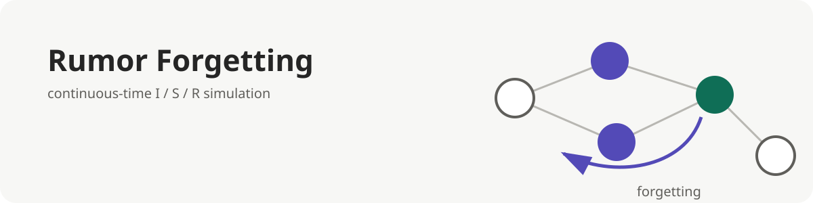

<p align="center"></p>

**English** | [日本語](README.ja.md)

# Rumor Forgetting

Companion code for a Zenn article about a continuous-time I/S/R rumor model with forgetting. It includes a Rust Gillespie simulation, an independent Python RK4 reference, validation checks, aggregation, and plotting.

## Quick start

Rust and [uv](https://docs.astral.sh/uv/) are required. Development runs must use `--scratch`.

```bash
uv sync
uv run rumor-tools ode --out reference.csv
cargo test
cargo run --release -- check --scratch
cargo run --release -- run --config configs/main.toml --seeds 0 --scratch
```

See [Model and implementation](docs/model.md) and [CLI and reproduction](docs/cli.md) for details.

## License

[MIT License](LICENSE)
